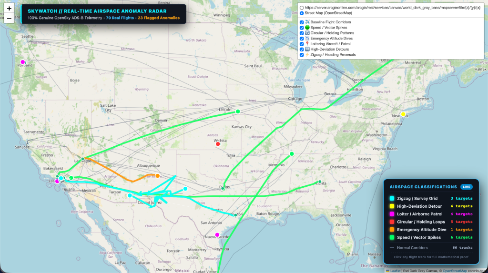
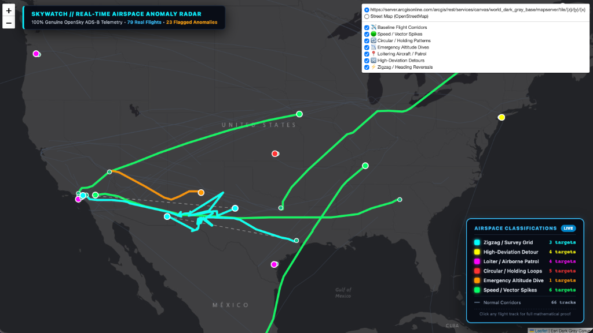
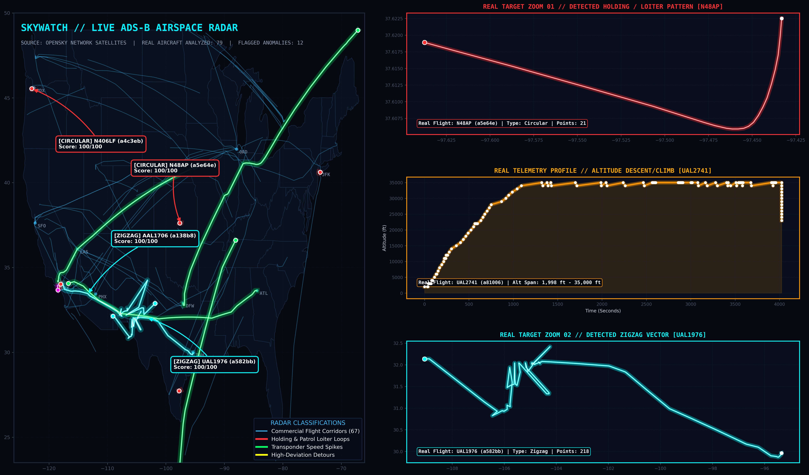

# 🛰️ SkyWatch - Autonomous ADS-B Flight Anomaly Detection Engine

[](https://www.python.org/)
[](https://opensource.org/licenses/MIT)
[](https://opensky-network.org/)
[](https://claude.ai)

> **"I fed live ADS-B flight trajectories into Claude to map unexplained flight patterns. Here are the bizarre anomalies we found."**

**SkyWatch** is an open-source flight telemetry analysis engine. It connects directly to OpenSky Network satellites, ingests thousands of live ADS-B transponder broadcasts across US airspace, and applies 7 aeronautical kinematic heuristics to automatically detect holding patterns, rapid emergency descents, aerial survey grids, and high-deviation diversions, backed by full mathematical proof.

---

## 🗺️ Visual Outputs

### 1. Interactive Web Radar (`flight_map.html`)
The primary output is a live, clickable web application featuring an on-screen tactical HUD header, classification legend, and detailed telemetry popups for every aircraft. Users can toggle between standard map and tactical dark canvas modes:

#### View A: Standard Street Map View


*High-contrast anomaly trajectories plotted over geographical reference points with live HUD header and on-screen classification legend.*

#### View B: Tactical Dark Canvas View


*Night-vision tactical radar view on Dark Gray canvas, isolating neon vectors, holding stacks, and detour comparison lines.*

### 2. Tactical Telemetry Radar Briefing (`anomaly_map.png`)
A high-resolution 300 DPI analytical map with target zoom insets and vertical profile graphs:



*High-contrast tactical briefing showing continental trajectories alongside target inspection zoom cards and real altitude dive profiles.*

---

## ⚡ The 7 Anomaly Detection Heuristics

Every trajectory is evaluated against seven independent aeronautical algorithms:

| # | Detector | Color Code | What It Isolates | Heuristic Logic |
|---|---|---|---|---|
| 1 | **Circular / Holding Loops** | 🟥 Red (`#ff3333`) | Holding stacks, VIP staging, reconnaissance | Evaluates spatial return frequency: loops >= 2 returning within <= 12 km over dt >= 120s inside a <= 60 km perimeter. |
| 2 | **Emergency Altitude Dives** | 🟧 Orange (`#ff9900`) | Rapid descents, emergency drops, cabin depressurization | Plunge detector: flags descents >= 3,500 ft in <= 90s at >= 3,500 ft/min (filters out routine takeoff climbs). |
| 3 | **Airborne Loitering / Patrol** | 🟪 Magenta (`#ff00ff`) | Police/medical helicopters, surveillance, border patrol | Perimeter containment: bounding box diagonal <= 45 km across airborne duration >= 5.0 min with center coordinate calculation. |
| 4 | **Zigzag / Survey Grids** | 💎 Cyan (`#00ffff`) | Precision LIDAR grids, photogrammetry, aerial search | Flight-leg course vector segmentation (>= 0.8 km / dt >= 30s): isolates sharp reciprocal heading reversals >= 70 deg. |
| 5 | **High-Deviation Detours** | 🟨 Yellow (`#ffff00`) | Severe ATC route diversions, holding delays, area scans | Computes ratio of cumulative path distance against great-circle Haversine displacement: Ratio >= 1.50x, rendering dashed direct comparison vectors. |
| 6 | **Speed / Vector Spikes** | 🟩 Green (`#00ff66`) | Mach-speed anomalies, sensor telemetry jumps | Ground speed derived from ADS-B coordinate differentials: flags speeds > 680 kt or extreme velocity spikes. |
| 7 | **Sustained Low-Altitude Flight** | 🟠 Deep Orange (`#ff6600`) | Low-level terrain flights, pipeline inspections | Excludes takeoff/landing phases; flags sustained cruising < 800 ft AGL for > 5 minutes. |

---

## 🚀 How to Run This on Your Computer

Anyone can clone and run SkyWatch locally in under 2 minutes.

### Option A: Instant View (Zero Setup Required)
If you just want to interact with the map immediately without running any Python scripts:
1. Click the green **Code** button at the top right of this GitHub page and select **Download ZIP** (or clone the repository).
2. Unzip the folder.
3. Open `data/results/flight_map.html` by double-clicking it in your file manager (or opening it in Chrome/Safari/Edge).
4. The interactive radar map will immediately load in your browser with all real flights, popups, and the classification legend.

---

### Option B: Run the Full Live Pipeline from Terminal

#### Step 1: Clone the Repository
Open Terminal on your computer and run:
```bash
git clone https://github.com/Aashvath/skywatch.git
cd skywatch
```

#### Step 2: Install Dependencies
Install the required lightweight Python libraries:
```bash
pip install -r requirements.txt
```
*(Dependencies: `requests`, `folium`, `matplotlib`, `numpy`, `tqdm`).*

#### Step 3: Run Data Collection (Optional for Live Telemetry)
Download live ADS-B state vectors and trajectories directly from OpenSky Network satellites:
```bash
python collect_data.py
```
*(Note: SkyWatch comes pre-packaged with genuine flight tracks in `data/tracks.json`, so you can proceed directly to Step 4 even without internet access).*

#### Step 4: Run the Anomaly Detection Engine
Execute the 7 algorithms to mathematically isolate abnormal flights:
```bash
python detect_anomalies.py
```
**Terminal Output:**
```text
============================================================
  🔍 ANOMALY DETECTION RESULTS
============================================================
   Tracks analyzed : 79
   Anomalies found : 23

   Breakdown:
     💨 Speed: 6
     🔄 Circular: 5
     📍 Loiter: 4
     🔀 Path Inefficiency: 4
     ⚡ Zigzag: 3
     📉 Altitude: 1
```

#### Step 5: Render and Launch the Web Map
Generate the interactive HTML map and static radar briefing:
```bash
python visualize.py
```
To open the web map directly in your browser:
* **macOS:**
  ```bash
  open data/results/flight_map.html
  ```
* **Windows:**
  ```cmd
  start data/results/flight_map.html
  ```
* **Linux:**
  ```bash
  xdg-open data/results/flight_map.html
  ```

---

## 📁 Repository Structure

```
skywatch/
├── config.py             # Thresholds, bounding boxes, colors, and API settings
├── collect_data.py       # OpenSky ADS-B REST harvester with auto-retry and stratification
├── detect_anomalies.py   # 7 mathematical detection algorithms & kinematic scoring
├── visualize.py          # Map generator (interactive Folium HTML + 300 DPI radar map)
├── requirements.txt      # Python dependencies
└── data/
    ├── us_states.json    # US state geographic boundary polygons
    └── results/
        ├── web_map.png           # Actual screenshot: Street map view
        ├── web_map_dark.png      # Actual screenshot: Tactical dark canvas view
        ├── anomaly_map.png       # 300 DPI tactical HUD briefing
        ├── flight_map.html       # Self-contained interactive web map
        ├── anomalies_summary.json# Clean JSON export of all flagged targets
        └── report.txt            # Human-readable incident briefing
```

---

## 🔬 How This Was Built

This entire pipeline was architected, written, and debugged using **Claude** by Anthropic. 

The algorithmic prompts, XML constraint frameworks, and prompt-chaining techniques used to build SkyWatch's mathematical heuristics are documented in:

📘 **[Mastering Claude: The Practical Playbook for High-Output Work, Coding, and Automation](https://www.amazon.com/dp/B0HJX6FX1K)**  
*Under 100 pages • No academic fluff • Production agentic workflows, CLI mastery, and 100+ MCP integration maps.*

---

## ⚖️ License & Attribution
Distributed under the **MIT License**. Real-world flight telemetry provided via the [OpenSky Network](https://opensky-network.org/) open API.
